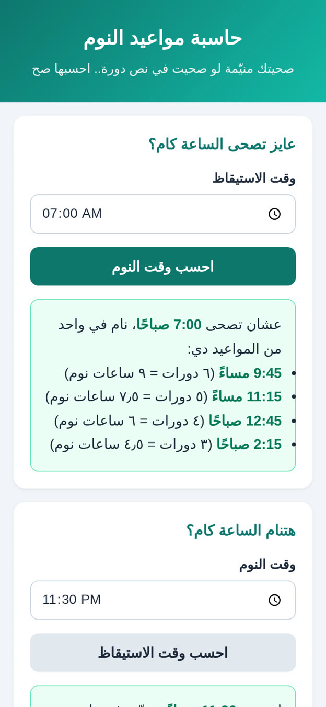

# Sleep Cycle Calculator | حاسبة مواعيد النوم

Find the best time to sleep or wake up based on 90-minute sleep cycles, so you wake up at the end of a cycle feeling rested. Arabic interface.

**Live app:** https://abood-ayman.github.io/sleep-calculator-ar/

**LinkedIn:** [Project entry](https://www.linkedin.com/in/abdullah-ayman-1678b737b/details/projects/)

This is a personal project, built with AI tools.

## Features
- Want to wake at a set time? Get 4 suggested bedtimes
- Going to sleep at a set time? Get 4 suggested wake-up times
- Based on 90-minute sleep cycles plus a 15-minute average to fall asleep
- Shows the total hours of sleep each suggestion gives

## Note
Guidance only: 90 minutes is an average. Real cycles vary between people (80-120 minutes), so adjust to how your own body feels.

## Privacy
Everything runs in your browser. No data is stored or sent anywhere.

## Run locally
Open `index.html` in any browser. It is a single static page with no dependencies.

## Status
Stable.

## Copyright
MIT License - Copyright (c) 2026 Abdullah Ayman.
